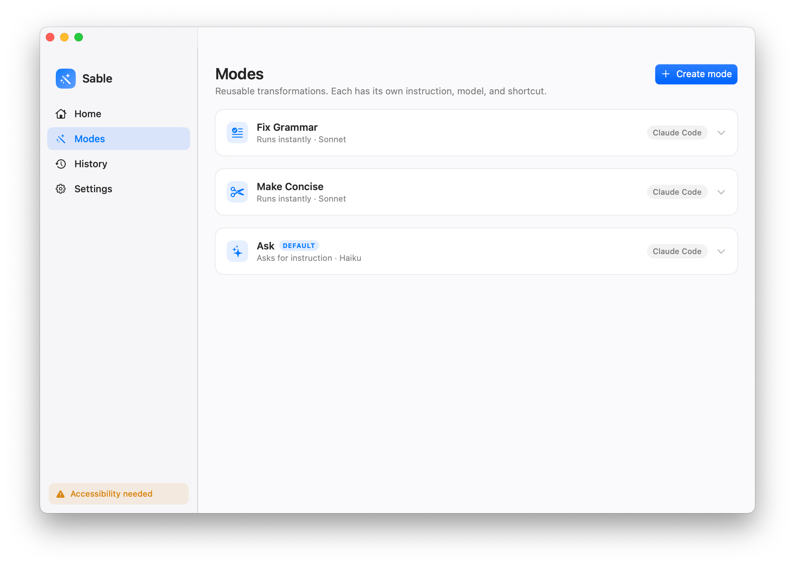

<div align="center">

# Sable

**Rewrite selected text, review it with Vim keys, and copy or paste it back.**



</div>

Sable is a macOS utility with reusable rewrite modes and global shortcuts.
ChatGPT and OpenRouter send text directly to their providers. Claude/Codex CLI
runtimes remain available as an explicit advanced option. Existing custom modes,
instructions, model settings and shortcuts are preserved.

## Build

Requires macOS 13+ and a Swift toolchain. CLI agents are needed only when you
select the advanced CLI provider.

```sh
git clone https://github.com/shadowfax92/sable.git
cd sable
make build                 # creates an ad-hoc-signed ./Sable.app
make CONFIG=debug build    # optional debug bundle
make test                  # headless tests
make install               # installs to /Applications; INSTALL_DIR overrides it
make run                   # build and launch when you are ready
```

## Connect a provider

Open Settings and choose **Continue with ChatGPT**. Sable opens your system
browser only when you request sign-in. Authorize Sable and enable ChatGPT plan
usage. Eligible Plus/Pro accounts can use their plan; availability also depends
on the selected account, workspace and policy. Identity-only sign-in does not
enable rewrites: use **Enable usage sharing** to grant plan permission.
See OpenAI's [current eligibility](https://developers.openai.com/siwc/quickstart) and [sign-in documentation](https://developers.openai.com/siwc/token-sharing-open-source/sign-in).

Successful plan authorization selects ChatGPT app-wide, unless you explicitly
chose another provider while sign-in was pending. Per-mode overrides and legacy
CLI settings remain intact. A canceled or failed replacement sign-in preserves
the previous verified connection. Reconnect from Settings if a session expires;
manage plan limits at [ChatGPT Settings → Usage](https://chatgpt.com/settings/usage).
Sable never reads another app's Codex/Claude credentials.

For **OpenRouter**, explicitly select OpenRouter in Settings and save your own
API key in its protected entry field. The key is stored separately from settings
at `~/.config/sable/openrouter-key` (0600, in a 0700 directory). Remove it from
Settings when no longer needed. Choose a text model by its OpenRouter model ID;
the default is `openai/gpt-4.1-mini`. OpenRouter uses your API credit. Failed
ChatGPT requests never switch to OpenRouter, a CLI, another model or another
billing path automatically.

## Rewrite and review

1. Grant Accessibility in System Settings → Privacy & Security → Accessibility.
2. Select text in your source app.
3. Press **⌃⌥⌘Space**, choose a mode, and enter an instruction if it asks.
   Modes can also have their own direct shortcuts.
4. Review the completed result. Nothing is automatically copied in Review mode.
5. In Normal mode, **Enter copies the final edited output and closes**.
   **Cmd-Enter copies and attempts to paste into the captured source app**.

Paste-back checks the exact live source application and its frontmost PID before
posting Cmd-V. If activation, Accessibility, secure input or delivery prevents a
safe paste, the output stays on the clipboard and a **Copied only** notice tells
you to focus the destination and press Cmd-V yourself. Copy-only acceptance
returns focus without posting a paste key. Paste-back also leaves the result on
the clipboard.

Choose **Copy immediately** in Settings (or per mode) to skip review, copy the
completed result and dismiss safely. An instant direct mode shortcut uses a
non-key progress pill for this workflow. A new invocation cancels the previous
interaction; late results cannot overwrite the current output or close its panel.

Selection capture tries Accessibility first, then a temporary Cmd-C fallback.
The fallback restores the previous clipboard before review. A newer clipboard
ownership change is preserved; cancel/discard never overwrites a copy you made
while editing. History keeps final accepted and discarded edits, and distinguishes
Review, Copied, Pasted, Discarded, Cancelled and Failed. An incomplete provider
stream is a failure and never becomes a successful result.

## Keyboard controls

| Context | Keys |
| --- | --- |
| Picker | arrows, Ctrl-J/K or Ctrl-N/P move; Enter picks; Esc closes |
| Normal movement | `h j k l`, `w b e`, `0 ^ $`, `gg G`; counts for supported motions |
| Enter Insert | `i a I A o O` |
| Edit | `x`, `dd`, `dw`, `cw`, `ciw`, `d$` / `D` / `C` |
| Undo / redo | `u` / Ctrl-R in Normal/Visual; Cmd-Z / Cmd-Shift-Z in every mode |
| Visual / local register | `v`, `y`, `d`, `p` / `P`; use Cmd-C for an explicit system clipboard copy |
| Leave Insert | Esc, `jk` or `jj` within the chord window; slower typing remains literal |
| Leave Visual | Esc returns to Normal |
| Accept | Enter in Normal/Visual copies; Cmd-Enter accepts and pastes |
| Insert Enter | Inserts a newline |
| Discard | Clean Normal Esc; an edited buffer needs a second Esc within 1.5 seconds |

Esc clears a pending count/operator before discarding. The editor supports these
basic Vim operations rather than a full Vim environment. Mouse selection, native
text input and IME use the native editor.

## Modes, settings and permissions

Modes define a name, instruction, icon, optional instruction prompt, optional
provider/model and result-handling overrides, and a direct shortcut. Open Modes,
History or Settings from the utility window; **Cmd-,** opens Settings.

Preferences live in `~/.config/sable/settings.json`; credentials never live there.
New installs select ChatGPT; existing installs keep their provider until an
explicit choice or successful Continue with ChatGPT. Review is the default for
both new and existing installs. The advanced CLI section preserves Claude/Codex
paths, working directory, timeout and per-mode CLI model aliases.

**Screenshots are optional and off by default.** Enable
`attachesScreenshotsForCLI` only for the advanced CLI path. Capture is deferred
until such a run starts. ChatGPT/OpenRouter are text-only and never take a
screenshot, even if that toggle is enabled. Screen Recording permission is needed
only for that optional CLI attachment; direct rewrites do not require it.
Accessibility supports selection fallback and paste-back.

`make build` uses ad-hoc signing. If macOS invalidates an Accessibility grant after
a rebuild, re-enable Sable in System Settings. Headless tests do not verify live
sign-in, authenticated inference or paste-back into your apps; those require an
owner-run check after installation.
